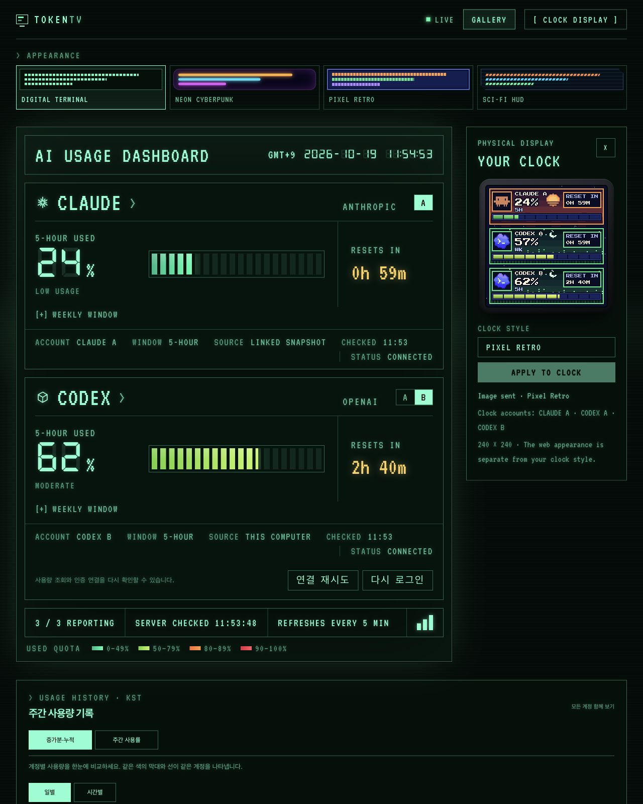

# 동일 서비스의 여러 계정 표시

한 TokenTV 인스턴스에서 설정 순서의 첫 3개 계정을 시계에 표시합니다.
예: `CLAUDE A / CODEX A / CODEX B` 또는 `CODEX A / CODEX B / CODEX C`.
각 행의 사용량·리셋 시각·로그인/OLD 상태는 해당 계정에 속하며 합산하지 않습니다.
웹에서는 기존 서비스 카드의 A/B/C 탭으로 계정을 전환하고 사용량 기록에서는 각 계정을 비교합니다.


위 그림은 예시 사용률 `24% / 57% / 83%`입니다. 모든 화면은 실제 렌더러의 240×240 출력이며,
Space의 두 Codex 캐릭터에도 `CODEX A`, `CODEX B` 이름을 붙여 구분합니다.

## 계정 추가

실행 중인 앱을 먼저 멈춘 뒤 다음을 실행합니다. CODEX A가 있으면 CODEX B가 새 전용 홈으로 추가됩니다.

```bash
token-tv add-account --provider codex --email second@example.com
token-tv connect --account codex_b
token-tv run
```

기존 계정은 다시 로그인할 필요가 없습니다. 이미 등록된 이메일은 거부하며, 다른 계정의 홈이나
이미 존재하는 새 슬롯의 홈을 재사용하지 않습니다. Docker 명령은 [배포 가이드](docker.ko.md#같은-서비스의-계정-추가-codex-b)를 참고하세요.

## 검증 범위

- 전체 테스트 111개 통과
- 설정에 CODEX B 추가 후 기존 계정 메타데이터·합성 로그인 파일·DB 마커 보존 검사
- 같은 서비스 3행, 설정 순서, 로그인 오류/OLD 행 유지, 4개 이상의 계정은 웹에 유지
- 7개 시계 렌더러의 크기·형식·전송 용량 검사
- Linux AMD64 이미지에서 Claude/Codex CLI, 로그인 없는 Codex RPC, 가상 시계 JPEG/GIF 업로드·활성화·복원 확인
- 퍼블릭 이미지 12개 레이어 검사: 실행 계정의 로그인 파일·DB·설정이 포함되지 않음

로컬 통합 확인은 새 전용 Docker 볼륨과 `http://127.0.0.1:8788/`을 사용합니다.
기존 A 계정은 예시 스냅샷으로 대체하고 CODEX B만 새 계정으로 로그인합니다.
시계 화면은 로컬 가상 시계와 대시보드 미리보기에서 검증하므로 운영 시계와 분리됩니다.

## 새 CODEX B 실제 로그인 확인

2026-10-19 로컬 통합 확인에서 CODEX B의 공식 기기 인증이 완료됐으며,
계정 검증과 실제 5시간·주간 할당량 조회가 모두 성공했습니다.
세 계정의 주간 사용량 관측이 SQLite에 기록되고 가상 시계 전송 상태가 `ok`인 것을 확인했습니다.
아래 화면의 CLAUDE A·CODEX A는 예시 데이터이며 CODEX B만 실제 로그인 계정입니다.
`Image sent`는 로컬 가상 시계로의 전달 결과입니다.



## 게시 이미지

2026-10-19, Linux AMD64용 이미지를 다음 태그로 게시했습니다.
빌드는 기능 코드 커밋 `4ea2a3c6537ac6d20ae783e73014d7ce3b2e557a`를 사용했습니다.

```text
public.ecr.aws/x2l9m6x8/token-tv:multi-account-4ea2a3c
public.ecr.aws/x2l9m6x8/token-tv:latest
```

두 태그의 manifest digest:

```text
sha256:b13caffb89c577c32d58a0753a90c2687310f8b49b33c758e9557233f2dfc2f2
```

운영 반영 시에는 새 이미지 배포와 기존 설정에 대한 계정 추가가 필요합니다.
기존 앱을 멈추고 `add-account`로 새 계정만 추가한 뒤 재시작하며, 새 계정은 해당 서버의
전용 홈에서 로그인합니다. 로컬 테스트 로그인은 로컬 볼륨에만 있으며 이미지로 전송되지 않습니다.
