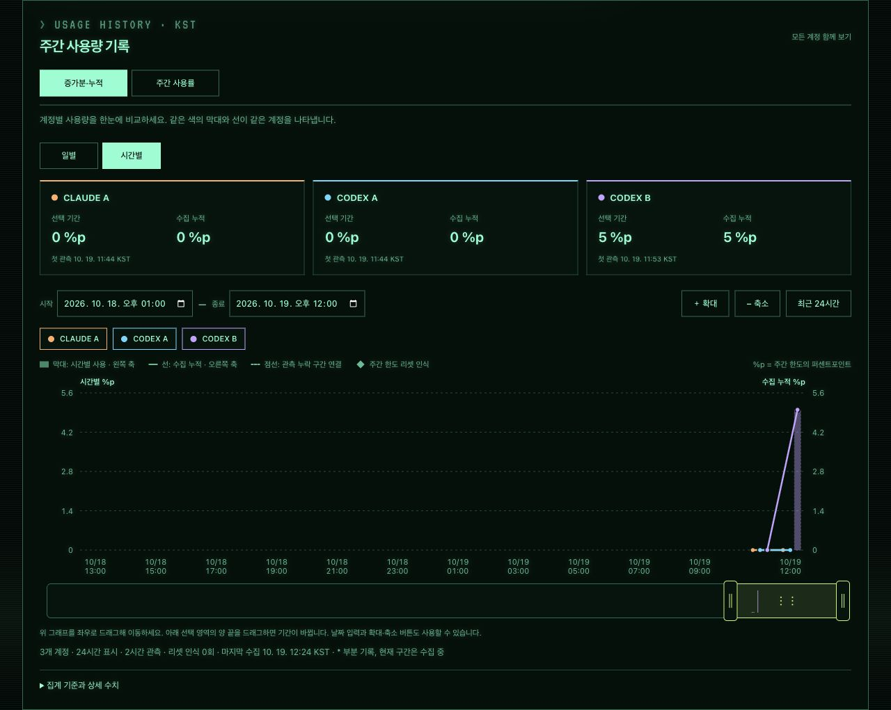
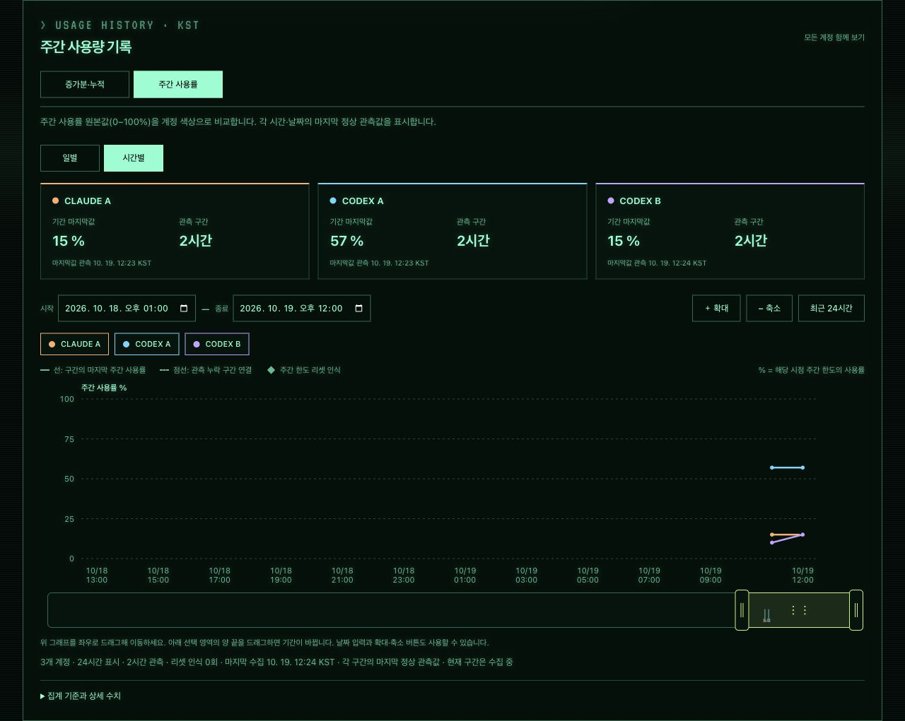
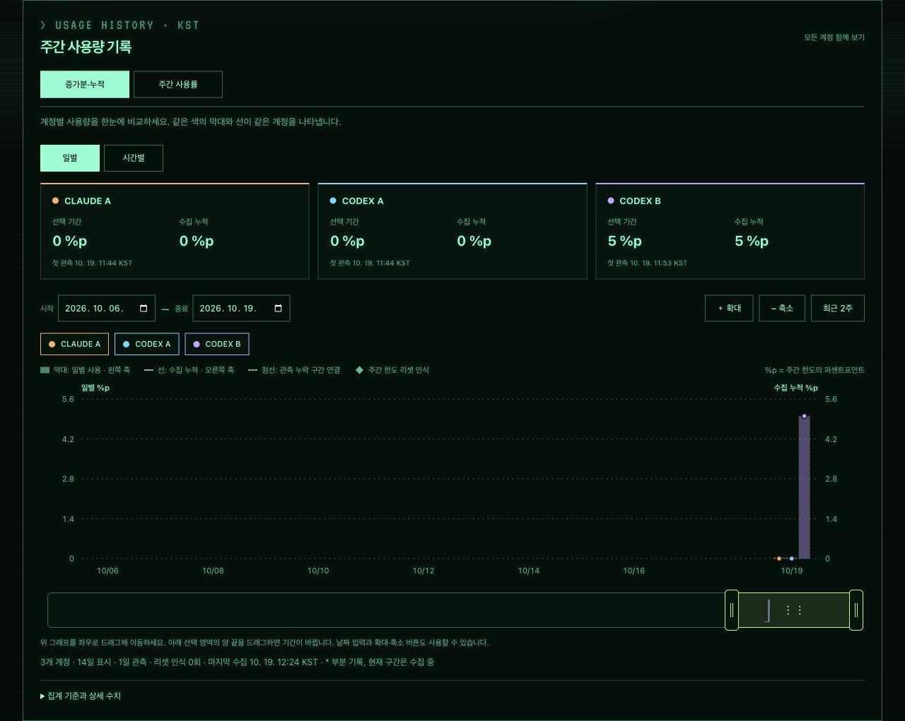

# CODEX B와 주간 사용량 화면

## 계정과 시계

- 한 TokenTV에서 CLAUDE A, CODEX A, CODEX B를 함께 사용합니다.
- 시계의 세 번째 행에 **CODEX B**가 표시됩니다.
- 같은 서비스도 A/B/C로 구분하며, 시계 화면 7종에서 계정 이름을 확인할 수 있습니다.
- 대시보드의 CODEX 카드에서 A/B를 선택해 각각의 사용량을 봅니다.

## 주간 사용량 대시보드

CODEX B도 기존 사용량 기록 기능을 동일하게 이용합니다.

- CODEX B는 **보라색**으로 구분됩니다.
- **일별 / 시간별**로 전환할 수 있습니다.
- **증가분·누적** 탭에서 막대와 누적선을 확인합니다.
- **주간 사용률** 탭에서 시간에 따른 사용률을 확인합니다.
- 계정별 그래프를 켜고 끄거나, 날짜 범위와 드래그·확대·축소로 조회 기간을 바꿀 수 있습니다.
- 새 계정의 기록은 첫 로그인 후 정상 조회된 시점부터 표시됩니다.

### 시간별 증가분과 누적

### 주간 사용률

### 일별 기록

## 사진 안내

사진은 로컬에서 확인한 화면입니다. CODEX B는 실제 로그인 계정이며,
CLAUDE A와 CODEX A는 예시 데이터입니다. 시계 미리보기는 로컬 가상 시계의 화면입니다.
사진 속 값은 촬영 당시 값으로, 사용에 따라 달라집니다.

## 운영 반영 상태

새 이미지는 ECR에 게시됐습니다. 운영 서버에서는 새 이미지 적용과 CODEX B 등록·로그인이 필요합니다.
기존 A 계정을 다시 로그인할 필요는 없습니다. 게시 이미지에는 로그인 정보가 포함되지 않습니다.

## 시계 화면 7종

아래는 화면을 비교하기 위한 예시 데이터입니다.

